# Clash 与 Tailscale 共存排查指南

本 Skill 帮助排查 **Clash (Clash Verge Rev / Mihomo / Clash Meta) TUN 模式** 与 **Tailscale** 同时运行时的 DNS、路由和连接问题。不同系统版本、DNS 模式、网络和 Clash 配置会产生不同结果；下列机制是待验证的假设，不是普遍根因。先收集本机证据，再决定是否调整配置。

---

## 核心冲突模型与机理

可能相关的机制包括：

```mermaid
flowchart TD
    subgraph Conflict1["1. DNS 抢占与投毒"]
        A1["启用 Tailscale DNS 接管"] -->|部分配置会改变系统 resolver| A2["查询路径发生变化"]
        A2 -->|需检查实际上游与返回值| A3["可能出现解析差异"]
    end

    subgraph Conflict2["2. IPv6 Happy Eyeballs 黑洞"]
        B1["目标同时有 A 与 AAAA 记录"] -->|客户端选择 IPv6 路径| B2["IPv6 路由或代理路径异常"]
        B2 -->|需分别测试 v4 / v6| B3["确认或排除 IPv6 路径"]
    end

    subgraph Conflict3["3. Clash 内核物理绑定陷阱"]
        C1["Clash 使用接口自动检测或显式绑定"] -->|具体行为取决于内核与配置| C2["出站接口可能与预期不同"]
        C2 -->|检查路由与连接证据| C3["确认或排除接口选择问题"]
    end
```



---

## 终极解耦架构

以下是可选配置方向。按需选择并一次只改一项；保留原配置以便恢复。

| 组件 / 维度 | 责任分工 | 关键策略 |
| :--- | :--- | :--- |
| **Tailscale DNS** | 按需提供 MagicDNS 和 tailnet DNS | 仅在证据表明系统 DNS 路径导致故障时，评估关闭接管；关闭后 MagicDNS 可能不可用 |
| **Clash (Mihomo)** | 按本机配置执行流量分流与 DNS 解析 | 检查实际 DNS 上游、Fake-IP 与规则配置；不要将某种模式视为通用修复 |
| **Tailscale 内网解析** | 由 MagicDNS、系统解析器或按需映射提供 | 优先保留 MagicDNS；静态 hosts 映射需确认节点身份和当前地址，并在节点地址变化时更新 |
| **本地网络** | 维持网络所需的 IPv4 / IPv6 配置 | 只有 v6 专项测试确认路径异常时才考虑临时关闭 IPv6；这可能影响其他网络服务 |
| **TUN 路由** | 排除 Tailscale 与代理服务端网段 | 排除 `100.64.0.0/10`、`fd7a:115c:a1e0::/48` 及代理 VPS 物理 IP |

---

## 五步排查 SOP

### 步骤 1：检查系统 DNS 路径
比较系统 resolver、Tailscale DNS 和故障域名的解析结果：
```bash
scutil --dns
tailscale status
dig example.com
dig @100.100.100.100 example.com
```
`resolver #1` 为 `100.100.100.100` 只说明系统首选 resolver 是 Tailscale DNS，不足以证明公网 DNS 被投毒。检查实际返回值和上游路径后再归因。

若证据表明系统 DNS 接管导致故障，可评估关闭它。关闭后 MagicDNS / tailnet DNS 可能不可用；先记录原设置并确认替代解析路径，再执行：
```bash
tailscale set --accept-dns=false
```
若更改前启用了接管，恢复命令为 `tailscale set --accept-dns=true`。较保守的替代方案是保留 Tailscale DNS，只调整 Clash DNS 上游、规则或接口选择，并验证 `.ts.net` 名称仍能解析。

---

### 步骤 2：验证 IPv6 路径后再决定是否调整
先对同一目标分别测试 IPv4 与 IPv6，并查看 Wi-Fi 当前状态和 IPv6 路由。只有 v6 失败而 v4 正常时才考虑临时关闭；关闭可能影响其他依赖 IPv6 的应用和服务。当前设置为 Automatic 时可执行：
```bash
curl -4 -I --connect-timeout 5 https://<目标域名>/
curl -6 -I --connect-timeout 5 https://<目标域名>/
networksetup -getinfo Wi-Fi
route -n get -inet6 <目标IPv6地址>
networksetup -setv6off Wi-Fi
```
恢复 Automatic 模式：`networksetup -setv6automatic Wi-Fi`。若原设置是 Link-local 或手动模式，不要用 Automatic 覆盖；先记录并按原模式恢复。物理接口修改对 Tailscale 虚拟接口的影响也应单独验证。

---

### 步骤 3：配置 Clash 规则与排除路由
以下仅为配置检查示例，不是通用处方。先备份当前配置，并确认当前 Clash 内核版本支持这些字段；每次只调整与已观察到的故障相符的一项，然后复测。

#### 1. TUN 模式排除 Tailscale 流量
```yaml
tun:
  enable: true
  stack: gvisor
  auto-route: true
  strict-route: false
  route-exclude-address:
    - 100.64.0.0/10          # Tailscale IPv4 全网段
    - fd7a:115c:a1e0::/48     # Tailscale IPv6 ULA 全网段
    - <VPS_IP_1>/32          # 你的代理节点公网物理 IP
```

#### 2. 按需调整 DNS / IPv6 配置
```yaml
ipv6: false

dns:
  enable: true
  ipv6: false
  enhanced-mode: fake-ip
  fake-ip-range: 198.18.0.1/16
  # fake-ip-range6 的影响取决于内核和路由配置；先检查实际路由再调整
  fake-ip-filter:
    - "+.ts.net"
    - "*.ts.net"
    - "+.tailscale.com"
    - "+.tailscale.io"
```

#### 3. 直连规则前置 (Prepend Rules)
```yaml
prepend-rules:
  # 仅在 UDP/QUIC 路径已有故障证据时才考虑相应限制
  - PROCESS-NAME,Tailscale,DIRECT
  - PROCESS-NAME,tailscaled,DIRECT
  - PROCESS-NAME,IPNExtension,DIRECT
  - PROCESS-NAME,io.tailscale.ipn.macsys.network-extension,DIRECT
  - DOMAIN-SUFFIX,ts.net,DIRECT
  - DOMAIN-SUFFIX,tailscale.com,DIRECT
  - DOMAIN-SUFFIX,tailscale.io,DIRECT
  - IP-CIDR,100.64.0.0/10,DIRECT,no-resolve
  - IP-CIDR6,fd7a:115c:a1e0::/48,DIRECT,no-resolve
```

---

### 步骤 4：必要时通过 Clash Hosts 静态映射 Tailscale 节点
通常优先保留 MagicDNS。只有确认 Clash 无法使用所需解析、且能够维护地址时才考虑静态映射。先查看设备并核验地址：
```bash
tailscale status
tailscale ip -4 <设备名>
tailscale ip -6 <设备名>
```
确认设备身份、tailnet 和目标地址后，才在 Clash 配置中添加映射（Clash Verge 可在 `Merge.yaml` 或当前激活 Profile 中添加）：
```yaml
hosts:
  "dobby.gleanvo.com": "<VPS_PUBLIC_IP>"
  "momomac-mini.tail4df241.ts.net": "100.116.36.36"
  "momomac-mini": "100.116.36.36"
  "dobby.tail4df241.ts.net": "100.105.207.63"
  "dobby": "100.105.207.63"
```
* **注意**：上述域名和地址仅为示例，不可直接照抄。静态地址可能过期；映射只影响解析，不保证路由或服务可达。备份配置，并在节点重命名、退出 tailnet 或地址变化时更新或删除映射。

---

### 步骤 5：彻底清理特权服务并重启 Clash Verge
在 macOS 上，Clash Verge 内核通常作为 root 特权服务运行。单纯保存文本文件不一定能热重载核心。
执行完整重启命令：
```bash
osascript -e 'quit app "Clash Verge"'
sleep 2
open -a "Clash Verge"
```

---

## 验证与验收清单

| 检查项 | 命令 / 方式 | 预期正常输出 |
| :--- | :--- | :--- |
| **DNS 路径** | `scutil --dns`、`dig <域名>` 与 `dig @<上游> <域名>` | 对照系统 resolver、指定上游和故障域名的返回值；不存在通用“正确 resolver” |
| **IPv4 / IPv6** | 对同一目标运行 `curl -4` 和 `curl -6` | 分别记录结果、错误和耗时；判断是否仅一条路径异常 |
| **公网访问** | 访问用户实际报告故障的目标 | 按目标服务可接受的响应码与超时基线判断，不以单一网站状态归因 |
| **Tailscale 内部域名** | `tailscale status`、`tailscale ip` 与实际服务探测 | 核对设备身份和当前地址，并确认名称解析与服务连通性 |

---

## 自动化体检与修复脚本

本 Skill 配套提供了诊断脚本：
```bash
# 运行环境体检
./scripts/diagnose_and_fix.sh

# 交互式修复（逐项确认；非交互运行会跳过修改）
./scripts/diagnose_and_fix.sh --fix
```
脚本会在对应检测项下显示恢复命令，并在每项系统设置修改前要求确认。它只报告状态，不判断该状态是否就是故障根因；先做 DNS 和 IPv4 / IPv6 对照测试，再决定是否确认。修改后重新验证公网域名、MagicDNS 名称和 tailnet 服务。
