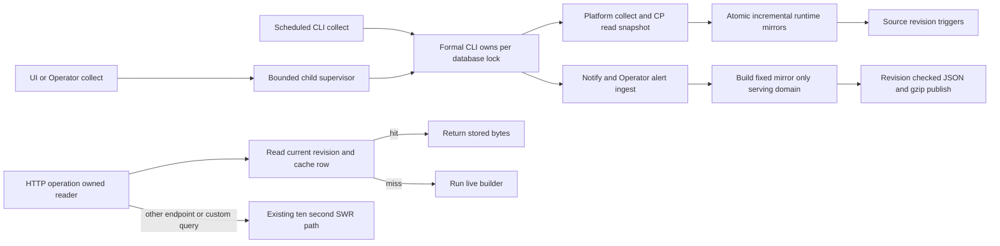

# Code Loop dashboard collection and serving performance

Dashboard collection now has one supervised process boundary. UI and Operator `collect_refresh` callbacks launch the formal CLI with argv, explicit database/project/config paths, a bounded deadline and output budget, and an atomically published result document. The CLI owns a stable per-database kernel lock from before database initialization through notify, Operator alert ingestion and serving cache publication. The watchdog cursor remains owned by the merged serving process. The old inline `make_refresh` API still accepts its `on_alerts` callback and shares the same lock discipline.

The six CP runtime mirrors now use stable identities and per-row content fingerprints. Identical snapshots do not write mirror rows after legacy fingerprint backfill; changed rows update in place, missing rows are deleted, and the six-table project projection is atomic. Source CP tables are materialized under one read transaction and closed before the dashboard writer transaction begins.

The dashboard adds a disposable JSON/gzip read model for three bounded views: default `/api/items`, default `/api/operator`, and `/api/runtime?project=<known project>`. They share builders with the live route. Source-table triggers advance an integer revision on relevant inserts, updates or deletes, including direct and older writers. The project trigger watches only `id`/`org_repo`, not collection timestamps/configuration. A collect builds from one read snapshot and publishes both encodings only after checking the revision inside the publish transaction. HTTP requests only read the cache; misses and revision mismatches run the live route. Custom queries, `fresh=1`, and dynamic routes keep their prior behavior, including the ten-second stale-while-revalidate snapshots.

The implementation preserves operation-owned SQLite connections and supports SQLite `THREADSAFE=2`. It adds no third-party dependency, changes no API payload, and does not migrate the production database during implementation. The implementation detail and ownership flow are in [the module architecture](../modules/code-loop.md); approved behavior and acceptance criteria are in the [Spec](../../specs/2026-10-23-code-loop-dashboard-performance.md) and [Plan](../../plans/2026-10-23-code-loop-dashboard-performance.md).

## Expected / Delta

The diagram represents the implemented flow. Isolated baseline/optimized measurements and platform limits are recorded in the [dashboard performance QA](../../qa/2026-10-24-code-loop-dashboard-performance.md); the archive's historical benchmarks are not used as measurements of this implementation.
