# Operator to Worker Agent task flow

## Context

The approved [Plan](../../plans/2026-10-25-operator-review-handler-auto-dispatch.md) extends the Operator from serve-host rounds to machine-targeted work. The [Spec](../../specs/2026-10-25-operator-review-handler-auto-dispatch.md) defines PR repair, worker diagnosis, local runtime selection and allowlisted maintenance behavior.

## As-built flow

```mermaid
flowchart LR
    GH[New PR review / merge conflict] --> PE[Project CP event log]
    WS[Discover stall edge] --> PE
    PE -->|durable per-project cursor| OP[Operator consumer]
    OP -->|typed task| ML[Registry machine task ledger]
    ML -->|authenticated WebSocket + grant| WA[Resident WorkerAgent]
    WA -->|validate + idempotency journal| EX[WorkerTaskExecutor]
    EX -->|prepare Handler claim / worktree / bind| PC[Project Control Plane]
    EX -->|new process per command| CO[Coordinator runtime]
    CO -->|native Task tool| HA[Independent Handler child]
    EX -->|evidence + static action registry| MA[Diagnosis and maintenance]
    HA -->|verify / report / publish| PC
    EX -->|result + terminal event| ML
    ML -->|wake-only callback| OP
    ML -->|ordered durable event replay| OP
```

## Implemented boundaries

- Role split: the Operator is the CP-side global router; WorkerAgent is the resident machine ingress and supervisor; Coordinator is an ephemeral local agent for one task; Handler performs repository edits under the existing CP lifecycle. Diagnosis actions go through fixed local adapters.
- CP project events are the source for new `changes_requested`, merge-conflict and discover-stall edges. The CP event callback is wake-only; the Operator reads committed rows from the project event log, starts its cursor at the current tail, and advances only after successful ingest. A transaction rollback therefore cannot create a phantom task or cursor gap.
- Registry SQLite owns machine-targeted task state and per-machine task transition events. Dispatch rechecks machine status and project grant. Reports and task/event queries use the authenticated machine identity.
- The WorkerAgent validates typed envelopes and command IDs before starting work in a background thread. Its local SQLite journal prevents duplicate sessions and persists the PR fencing token needed to retry a lost failure report. It records the runtime PID; after an agent restart it watches a still-running process, and reports an uncertain failure after the process exits instead of replaying a potentially completed maintenance action.
- PR repair uses the existing Handler claim, isolated worktree, bind, verify, report and publish lifecycle. The worker validates the event's PR head/base against the claimed item before runtime launch. Runtime failure reports carry the execution/token fence so the CP can release the claim.
- Coordinator and model are selected on the worker from machine config with an optional project registration override. OpenCode runs standalone with task-specific permissions; Claude Code uses its native Task tool. Unsupported runtimes are refused before a PR claim.
- Worker diagnosis submits timestamped evidence to a tool-restricted runtime. The worker accepts action IDs only, rechecks permissions and active executions, and uses fixed Windows Task Scheduler/service adapters. Unsupported platforms and missing registrations are explicit unknown/refusal results.
- Task results remain queryable in the machine task ledger. The callback is wake-only; the Operator replays event IDs in machine order and advances its cursor only after successful ingestion. This avoids losing a lower-ID result if concurrent callbacks arrive out of order.
- Worker hello advertises supported task schema versions. Legacy workers without a compatible version keep tasks pending; reconnect only requeues expired tasks after both schema compatibility and project grant/local registration are known. Operator task TTL defaults to seven days. PR/head and stall freshness are checked again before work. CP expires pending tasks and fails unreported RUNNING tasks after five hours.
- Before PR repair, the worker verifies the current PR head SHA and base ref. A moved base SHA alone does not stale a repair task; a still-conflicted PR with a changed head or base SHA emits a fresh repair event so stale terminal tasks cannot strand it. Coordinator success must contain a native Task/subagent tool invocation and completed result, and the exact CP execution must be `SUCCEEDED`; a self-reported session ID or a completed child with an active/failed CP claim is insufficient.
- Before every diagnostic maintenance action, the worker confirms that the same last discover execution is still stalled. A resumed/new run invalidates the stale signal; duplicate action IDs are suppressed, and restart recovery does not replay completed actions.

## Docs impact and validation contract

`docs/architecture/modules/code-loop.md`, `docs/architecture.md` and `docs/architecture/modules.md` now describe the task ledger, event flow, WorkerAgent runtime and action boundary. The root README has no managed architecture picture block. This repository currently has Markdown architecture documents only; no L1-L3 JSON schema or `lint:arch` command is present, so no such gate applies. Targeted unit and contract tests cover the task paths, including rollback-safe wakeups, ordered replay, schema/grant/local-registration checks, stale-signal rejection, duplicate action IDs, and native Task evidence. Loopback HTTP/WebSocket integration tests are blocked in the managed sandbox because it denies local socket binding; they remain part of host-side QA.
