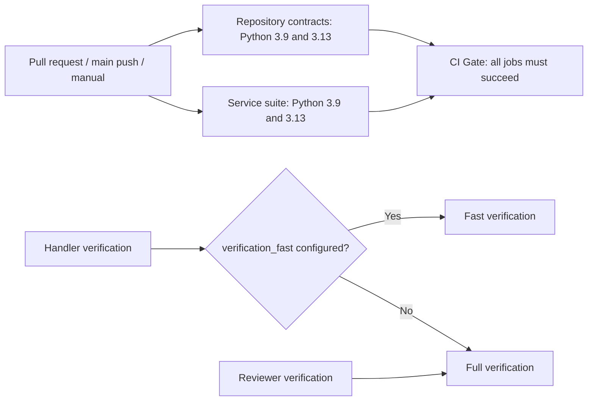

# Test tiers and GitHub Actions CI

Spec: [Test tiers and GitHub Actions CI](../../specs/2026-10-25-tiered-tests-actions-ci.md)

Plan: [Expected verification flow](../../plans/2026-10-25-tiered-tests-actions-ci.md)

## Change

The repository gains a Python 3.9 / 3.13 GitHub Actions workflow for root contract and code-loop service tests. The `CI Gate` aggregate reports failure unless both jobs pass. Contributors may use related tests for fast iteration and expand validation based on change risk. The code-loop documentation now reflects the already implemented `verification_fast` tier for non-reviewer execution and full verification for the Reviewer.

## Architecture impact

The change adds a hosted verification path and updates the contributor feedback loop. It does not change the service dependency direction, runtime boundaries, CP APIs, state model, or exam trust boundary. The workflow produces a stable check result; enabling it as a required merge check remains an explicit configuration in the target repository.

## Documentation

The root README, CLAUDE guide, code-loop skill references, service README, and architecture pages describe the new workflow and the existing test tiers. The repository has no formal JSON architecture specification or `lint:arch` command; this change keeps the existing Markdown architecture format.
