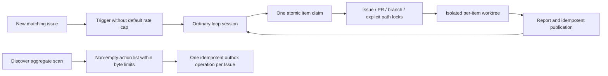

# Code Loop round throughput

## Context

The three worker loops had practical throughput ceilings: Handler issue and repair work used `path:*` even without configured scopes, the CP defaulted to three active executions per loop, and event triggers skipped whenever any execution was running. Discover also capped an aggregate publication report at ten Issue actions. See the [approved plan](../../plans/2026-11-01-code-loop-round-throughput.md) for the expected flow.

## As-built flow

## Implemented changes

- CP default parallel capacity is unlimited; a positive `max_parallel` remains supported. Item and fencing semantics remain one execution per item.
- Missing `issue_scopes` no longer becomes a whole-repository lock. Explicitly configured scopes remain conflict protected, as do Issue, PR and branch identities.
- Standard Handler and Reviewer instructions continue through the queue after each item is fully completed and cleaned. A dashboard-directed review remains scoped to the selected PR.
- Discover action lists are non-empty and use existing per-field and total request-size bounds instead of a ten-item cap. Publication retains per-item outbox keys and reconciliation.
- Trigger defaults no longer impose cooldown or daily limits and do not skip dispatch because another execution is active. A per-project file lock prevents concurrent scheduler ticks from losing cursor updates or duplicating spawns. Explicit positive limits still work.

## Docs impact and validation

Updated the loop rules, CP contract and module architecture in addition to this change record. No L1-L3 JSON architecture files, architecture overview matrix, managed README picture block, or `lint:arch` command exists in this repository; those gates do not apply. Focused tests and the service suite verify default concurrency, explicit limits and scopes, trigger dispatch, large discovery publication and partial-retry behavior.
