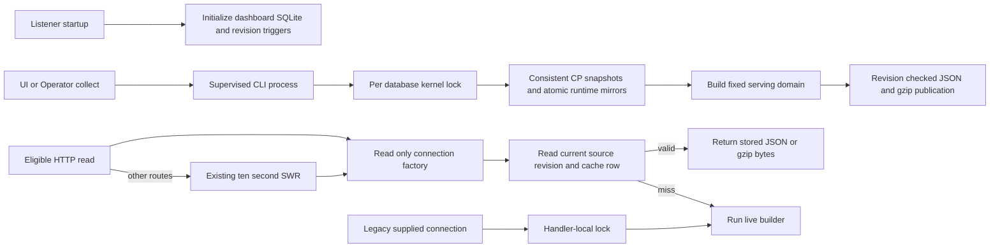

# Code Loop service architecture

## Responsibility and boundaries

`services/code-loop` is an independently runnable Python 3.9+ standard-library service. `scripts/cp_server.py serve` mounts the Control Plane listener and a loopback dashboard in one process. The thin `code-loop` skill delegates CLI operations to this service. Machine-local configuration, credentials and SQLite files live outside the repository.

The Control Plane owns project coordination, command ledgers, leases and platform publication. The dashboard derives views from collected facts; action callbacks own collection, replies and command dispatch. `cp.observer` supplies the shared platform snapshot store. The dashboard collector maintains incremental runtime mirrors and a disposable persistent serving model; neither becomes an authority for Control Plane state.

## Dashboard public interfaces and ownership

- `dash.schema.connect(path)`: initializes a writable dashboard store. It permits sequential thread handoff; callers must prevent simultaneous connection use.
- `dash.schema.connect_readonly(path)` (also exported by `dash.store`): opens an existing file read-only with URI-safe paths, autocommit and Python's thread-affinity check. It does not initialize schema or journal settings.
- `dash.serve.create(db, ..., db_factory=None)`: constructs the existing HTTP handler. Production passes a factory; each route evaluation, background recompute or POST validation opens and closes its connection on the same thread. All returned rows are materialized inside that scope. HTTP serialization, network writes and external action callbacks run after release.
- Without a factory, one handler-local reentrant lock protects complete reads on the caller-owned connection. This compatibility path does not coordinate unrelated external users; they must avoid concurrent access. The handler never closes a borrowed connection.
- The listener's initial dashboard connection remains for initialization and the optional operator consumer. HTTP readers do not use that connection. Operator work-item Store transaction ownership is a separate concern.
- `dash.collect.copy_runtime(db, pid, path)`: reads all six CP source tables in one read transaction, closes the source handle, then passes the materialized snapshot to `dash.ingest.replace_runtime`.
- `dash.ingest.replace_runtime`: uses project plus CP id as identity (lease resource for leases), additive row hashes, and one explicit transaction or caller-owned savepoint. Unchanged projections cause no mirror-table DML; a mid-round error rolls the six-table projection back together.
- `scripts/dashboard.py collect`: owns a stable `<dashboard DB>.collect.lock` kernel lock through collection, notification, Operator alert ingestion and serving-model publication. Lock ownership releases with the process; the lock file stays in place. `dash.refresh.make_process_refresh` starts this CLI with argv and supervises its deadline, output and atomic result file. The legacy inline `dash.serve.make_refresh` API keeps its callback contract and acquires the same lock.
- `dash.serving`: contains the shared pure builders for items, default Operator ledger and per-project runtime. SQLite triggers advance `serving_meta.source_revision` when their source rows change. A collect builds JSON and deterministic gzip from one read snapshot, then publishes both in a short transaction only if the revision still matches. These cache tables are disposable; reads never write them.
- The persistent cache covers only the exact default `/api/items`, `/api/operator`, and `/api/runtime?project=<known project>` URLs. A miss, unknown parameter, explicit `fresh=1`, unsupported format or stale revision uses the live route. Time-dependent, live-CP and custom-query routes retain the existing ten-second in-memory stale-while-revalidate policy.

For the legacy path the final step releases the lock instead of closing the connection. Writes use independently owned collector/action connections, preserving SQLite file-level coordination and WAL behavior.

The cache source inventory is declared in `dash.schema.SERVING_SOURCE_TABLES`: project identity, issues, PRs, comments, work items, executions, leases, outbox, CP events, Operator signals and Operator runs. The project trigger watches only `id` and `org_repo`; collection timestamps/config do not change these builders. `pr_reviews` is not a dependency. Revision triggers also catch direct SQL and older writer versions. Cache/meta writes do not trigger revision changes. If a revision advances while a batch is built, the entire old batch is discarded.

## Threading contract

Disabling `check_same_thread` does not enable serialized SQLite mode. A `THREADSAFE=2` build forbids simultaneous access to one connection and its statements. Operation ownership enforces that contract regardless of the SQLite build. See [SQLite threading modes](https://sqlite.org/threadsafe.html).

## Validation

Connection tests cover actual parallel HTTP requests, cold reads, failed reads, stale snapshot recomputes, POST validation, borrowed connection serialization and production listener wiring. Dashboard performance tests additionally cover atomic mirror rollback and idempotence, source snapshot consistency, lock release, subprocess deadlines and output bounds, revision invalidation/fencing, and cached gzip hits. Tests use separate temporary databases and never migrate production data in-place. Isolated merged-server QA records request latency, process CPU and post-load idle CPU. Removing unsafe sharing does not establish the precise internal cause of every SQLite native failure.
