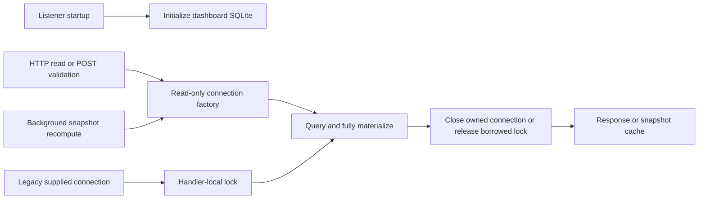
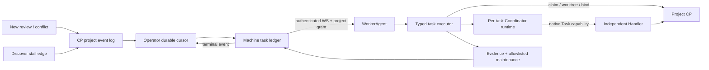

# Code Loop service architecture

## Responsibility and boundaries

`services/code-loop` is an independently runnable Python 3.9+ standard-library service. `scripts/cp_server.py serve` mounts the Control Plane listener and a loopback dashboard in one process. The thin `code-loop` skill delegates CLI operations to this service. Machine-local configuration, credentials and SQLite files live outside the repository.

The Control Plane owns project coordination, project command ledgers, machine task ledgers, leases and platform publication. The dashboard derives views from collected facts; action callbacks own collection, replies and command dispatch. `cp.observer` supplies the shared platform snapshot store.

### Operator, WorkerAgent, Coordinator and Handler

- **Operator** is the CP-side global operations coordinator. It consumes durable events across exposed projects and workers, routes authorized typed tasks, and tracks their results. It does not start a worker's local runtime.
- **WorkerAgent** is the worker's resident, authenticated ingress and execution supervisor. It validates machine identity, task schema, project grant and local registration; journals task state; and starts a fresh Coordinator runtime for each task.
- **Coordinator** is an ephemeral worker-local agent scoped to one task. For PR repair it delegates repository work to a separate Handler. For worker diagnosis it analyzes local evidence and returns only authorized action IDs. It does not edit the repository or run arbitrary shell commands.
- **Handler** performs the repository changes under the existing CP claim, worktree, verification, report and publication lifecycle. Deterministic local adapters execute any allowlisted machine maintenance action selected during diagnosis.

## Dashboard public interfaces and ownership

- `dash.schema.connect(path)`: initializes a writable dashboard store. It permits sequential thread handoff; callers must prevent simultaneous connection use.
- `dash.schema.connect_readonly(path)` (also exported by `dash.store`): opens an existing file read-only with URI-safe paths, autocommit and Python's thread-affinity check. It does not initialize schema or journal settings.
- `dash.serve.create(db, ..., db_factory=None)`: constructs the existing HTTP handler. Production passes a factory; each route evaluation, background recompute or POST validation opens and closes its connection on the same thread. All returned rows are materialized inside that scope. HTTP serialization, network writes and external action callbacks run after release.
- Without a factory, one handler-local reentrant lock protects complete reads on the caller-owned connection. This compatibility path does not coordinate unrelated external users; they must avoid concurrent access. The handler never closes a borrowed connection.
- The listener's initial dashboard connection remains for initialization and the optional operator consumer. HTTP readers do not use that connection. Operator work-item Store transaction ownership is a separate concern.

For the legacy path the final step releases the lock instead of closing the connection. Writes use independently owned collector/action connections, preserving SQLite file-level coordination and WAL behavior.

## Threading contract

Disabling `check_same_thread` does not enable serialized SQLite mode. A `THREADSAFE=2` build forbids simultaneous access to one connection and its statements. Operation ownership enforces that contract regardless of the SQLite build. See [SQLite threading modes](https://sqlite.org/threadsafe.html).

## Operator machine task flow

The CP keeps project work items and a separate machine registry. `cp.worker_tasks.WorkerTaskLedger` stores versioned, typed machine tasks and terminal transition events in the registry SQLite database. `CommandDispatcher` delivers only to enabled, enrolled machines, rechecking project grants before it sends a frame. A project repair task may route to any granted worker; a worker diagnosis task names its target machine. This separates the Operator's global routing authority from the Coordinator's local task scope and the WorkerAgent's resident transport role.

The Operator consumes durable project event IDs with a per-project cursor. New PR review requests, newly reported merge conflicts and discover stalls become `pr.repair` or `worker.project_diagnose` tasks. The first cursor starts at the event-log tail, so enabling the Operator does not backfill older PR state. PR reasons found in one sync are coalesced into one event. A merge conflict that persists across a new PR head or base SHA creates a fresh repair event. Discover stall events are edge-triggered and emit a resolution event after progress resumes. Both project-event and task-result callbacks only wake the Operator; it replays committed CP rows and machine event rows in ID order, advancing each durable cursor only after successful ingestion. A transaction rollback therefore cannot trigger work or advance a cursor.

`worker_task_protocol` rejects unknown task versions, targets, payload keys and action IDs. WorkerAgent hello advertises supported task schema versions; a legacy worker that does not announce a compatible version leaves tasks pending for upgrade. Operator tasks have a configurable TTL (seven days by default); when a worker reconnects, an expired task is requeued only if the machine still has the project grant, local project registration and compatible schema. Each handler revalidates current state before effects. `WorkerTaskRunStore` makes each local command ID idempotent and retains the failed PR claim fence, runtime PID and log path only on the worker. On WorkerAgent restart, an active runtime PID is watched rather than relaunched; an exited or unrecorded runtime is reported as an uncertain failure and its maintenance actions are never replayed. `worker_task_executor` preflights the local project registration and runtime before claiming PR work. It checks the PR head SHA and base ref while allowing the base branch SHA to advance. A PR repair succeeds only when runtime output proves the native Task/subagent tool was invoked and returned and the exact CP execution is `SUCCEEDED`; a Coordinator-written session ID alone is not evidence. The Coordinator's session is one-shot; prompts arrive through stdin and are removed after the process exits. OpenCode runs with a per-process profile that grants the primary only its native Task/subagent tool for repair and no tools for diagnosis. Claude Code is limited to its native Task tool for repair and read-only tools for diagnosis. Pi is rejected because this path requires subagent support.

Diagnosis samples worker identity and channel state, the local registration, CP status/items and recent executions, watchdog records, and any exact scheduler target registered in machine config. It explicitly marks missing evidence as unknown. Before each action, the worker verifies the stall is still present for the same last execution; a resolved or newer run makes the request stale. Duplicate action IDs in one model response are run once, and the local journal prevents replay after restart. Model output may name only action IDs allowed by both the task envelope and local registry. The worker runs fixed adapters; model-produced commands and targets are never executed. Initial platform actions use Windows Task Scheduler and Windows service APIs; unsupported platforms return an explicit refusal. Discover reruns require the CP to report no active discover execution. The CP marks a task left RUNNING for five hours as failed so it cannot block future work indefinitely.

Worker task results and status transitions are persisted in the machine task ledger and exposed through machine-authenticated list/event endpoints. Terminal results also reach the in-process Operator consumer. Dashboard project registration can override the worker's machine-level Coordinator agent/model; maintenance task/service registrations remain in the worker's global config or project override.

## Validation

Connection tests cover actual parallel HTTP requests, cold reads, failed reads, stale snapshot recomputes, POST validation, borrowed connection serialization and production listener wiring. Tests use separate temporary databases; they do not intentionally race the affected native shared connection. Real merged-server QA records request latency, process CPU and post-load idle CPU. Removing unsafe sharing does not establish the precise internal cause of every SQLite native failure.

Machine task tests cover durable event replay, grant-aware delivery, protocol validation, local idempotency, report ownership, claim release and allowlisted actions. A full loopback HTTP/WebSocket integration suite requires local socket binding; managed sandbox execution can validate its helpers and stores directly when loopback bind is unavailable.

## Automated verification

The repository's `.github/workflows/ci.yml` runs the code-loop service unittest suite on Python 3.9, the project's declared minimum supported version, on pull requests, pushes to `main`, and manual dispatch. A separate `CI Gate` job aggregates the service and repository contract jobs and fails closed when either job fails, is cancelled, or is skipped. The project's code-loop `verification_fast` configuration is a development feedback tier; the Reviewer continues to run the full configured `verification` suite. Only add the workflow check name to `.code-loop/verify.json` after confirming the check in the target repository. The Control Plane's existing base-commit configuration and anti-tampering boundaries remain unchanged.
