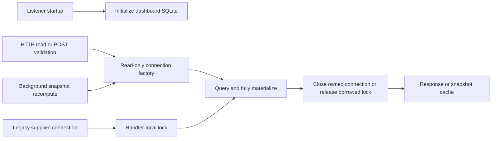

# Code Loop service architecture

## Responsibility and boundaries

`services/code-loop` is an independently runnable Python 3.9+ standard-library service. `scripts/cp_server.py serve` mounts the Control Plane listener and a loopback dashboard in one process. The thin `code-loop` skill delegates CLI operations to this service. Machine-local configuration, credentials and SQLite files live outside the repository.

The Control Plane owns project coordination, command ledgers, leases and platform publication. The dashboard derives views from collected facts; action callbacks own collection, replies and command dispatch. `cp.observer` supplies the shared platform snapshot store. This connection fix does not alter those responsibilities or transactions.

## Dashboard public interfaces and ownership

- `dash.schema.connect(path)`: initializes a writable dashboard store. It permits sequential thread handoff; callers must prevent simultaneous connection use.
- `dash.schema.connect_readonly(path)` (also exported by `dash.store`): opens an existing file read-only with URI-safe paths, autocommit and Python's thread-affinity check. It does not initialize schema or journal settings.
- `dash.serve.create(db, ..., db_factory=None)`: constructs the existing HTTP handler. Production passes a factory; each route evaluation, background recompute or POST validation opens and closes its connection on the same thread. All returned rows are materialized inside that scope. HTTP serialization, network writes and external action callbacks run after release.
- Without a factory, one handler-local reentrant lock protects complete reads on the caller-owned connection. This compatibility path does not coordinate unrelated external users; they must avoid concurrent access. The handler never closes a borrowed connection.
- The listener's initial dashboard connection remains for initialization and the optional operator consumer. HTTP readers do not use that connection. Operator work-item Store transaction ownership is a separate concern.

For the legacy path the final step releases the lock instead of closing the connection. Writes use independently owned collector/action connections, preserving SQLite file-level coordination and WAL behavior.

## Threading contract

Disabling `check_same_thread` does not enable serialized SQLite mode. A `THREADSAFE=2` build forbids simultaneous access to one connection and its statements. Operation ownership enforces that contract regardless of the SQLite build. See [SQLite threading modes](https://sqlite.org/threadsafe.html).

## Validation

Connection tests cover actual parallel HTTP requests, cold reads, failed reads, stale snapshot recomputes, POST validation, borrowed connection serialization and production listener wiring. Tests use separate temporary databases; they do not intentionally race the affected native shared connection. Real merged-server QA records request latency, process CPU and post-load idle CPU. Removing unsafe sharing does not establish the precise internal cause of every SQLite native failure.
