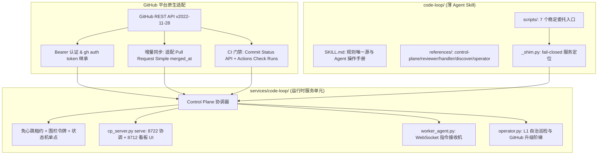

# Plan: code-loop 服务集成与 Skill 规范化改造（支持 GitHub 原生适配）

## 任务背景与目标

将 `code-loop` 服务单元与其对应的薄 Skill 集成到本仓库，完成以下核心目标：
1. 迁移代码平台适配层，由原有的 Gitea REST API 改造为原生的 GitHub REST API (v2022-11-28)，支持 Actions Check Runs 门禁、`gh auth token` 身份继承与 Pull Request Simple 增量爬取；
2. 建立符合 skills.sh 规范的 `code-loop/` 薄 Skill，提供统一动词面 CLI、深入参考规则文档与 fail-closed 运行时定位；
3. 遵循仓库 `vibe-coding` 与 `project-setup` 规范，补齐 spec/plan、规范化文档引用、修复审阅意见中的格式与契约漂移。

---

## 架构影响评估

Architecture Impact: Additive (Service & Skill Integration)
- 新增独立服务模块 `services/code-loop/`；
- 新增薄委托技能 `code-loop/` 与 `skills/code-loop` 软链兼容层；
- 新增 `tests/test_code_loop_repository.py` 仓库测试；
- 不对现有 `vibe-coding`、`prototype-first`、`project-setup` 产生破坏性变更。

---

## 方案流程图

---

## 实施与修复步骤

1. **GitHub 适配器健全性强化 (Issue 1, 2, 4)**：
   - 在 `codeloop/cp/github.py` 中支持从 `merged_at` 推导 `merged` 标志，使 Pull Request Simple 对象在增量爬取中不报字段缺失；
   - 在 `snapshot()` 中集成 Actions Check Runs API（`/commits/{sha}/check-runs`），无缝打通 GitHub Actions 门禁判定；
   - 增加 `gh auth token` 优雅回退（仅在 `token_env == 'GITHUB_TOKEN'` 时触发）；
   - 在 `test_control_plane_github.py` 中补充 4 项回归单测并验证全绿。
2. **Operator 规则文档契约拉齐 (Issue 3)**：
   - 修正 `references/operator.md` 中的动词目标格式表格，与 `codeloop/operator/wiring.py` 严格对齐（`command_resend`、`github_create_issue`、`github_comment_issue`、`escalate_human`）。
3. **项目配置与默认 URL 容错 (Issue 5)**：
   - `code-loop/SKILL.md` 配置示例增加 `"url": "https://api.github.com"`；
   - `runtime.py` 在给定 `repo` 但省略 `url` 时自动缺省填充 `https://api.github.com`。
4. **Shim 入口与系统路径解耦 (Issue 6)**：
   - 重构 `code-loop/scripts/` 中的所有 CLI 入口，使用 `importlib.util.spec_from_file_location` 动态加载 `_shim.py`，彻底杜绝把脚本目录推入全局 `sys.path`；
   - 恢复 `operator.py` 规范的第 1 行 shebang 与模块级 docstring，消除跨平台/运行时风险。
5. **文档链接与持久化 Spec/Plan 补齐 (Issue 7)**：
   - 在 `docs/specs/` 与 `docs/plans/` 中落本文档；
   - 更新 `services/code-loop/README.md` 指向对应设计 Spec。
6. **软链与跨平台测试健全性 (Issue 8)**：
   - 优化 `tests/test_code_loop_repository.py` 的软链断言，兼容无软链支持的操作系统环境；
   - 补齐 `.gitignore` 尾部换行符。
7. **全量门禁回归验证**：
   - 运行 `tests/` 全量仓库测试；
   - 运行 `code-loop/scripts/test_shims.py` 测试；
   - 运行 `services/code-loop/tests/` 全量 1,390+ 门禁测试。
