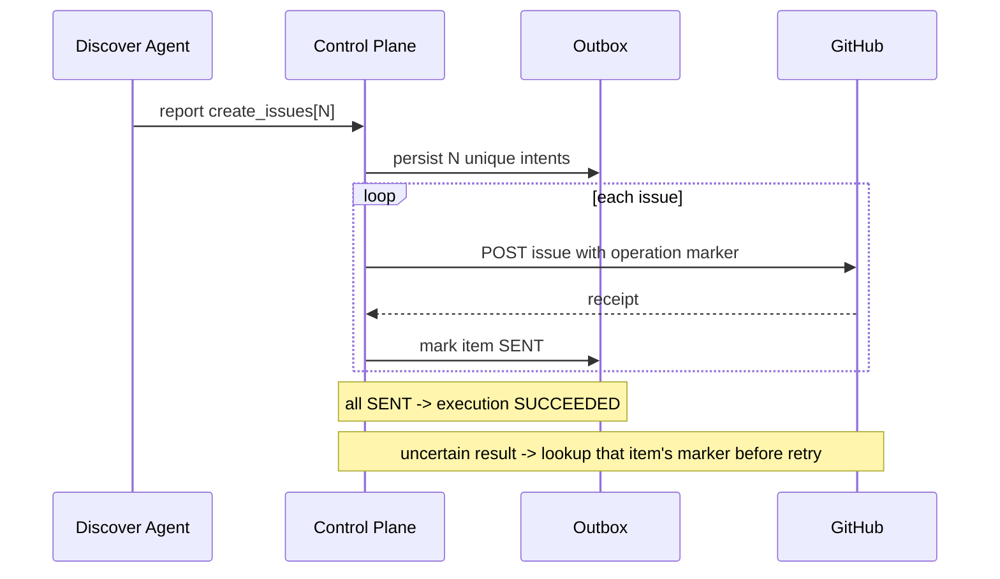

# Discover 批量创建 Issue 实施计划

## Plan

1. 为 Discover report 的 `actions` 数组定义严格 schema 和 Discover-only `create_issue` allowlist；保留现有单动作契约。
2. 在服务层把一个批次扩展为逐 Issue outbox intents；为每个条目派生稳定 operation ID 与唯一 marker。
3. 将批次索引接入 `publish/begin` / `publish/commit` worker 协议；逐项 prepare/write/reconcile，使部分成功可恢复、所有条目 SENT 后才完成 execution。
4. 保留 GitHub adapter 的单 Issue 校验、写入与 marker 查询；单项动作继续走原路径。
5. 更新 Discover 规则与通用 Skill 指引，要求只读检查、独立证据、开放 Issue/PR 去重、批量发布和队列确认。
6. 更新 Skills Discover 定时任务提示词，读取已安装的 code-loop 规范，执行完整 Discover 生命周期，并汇报每个新 Issue 或不创建的理由。
7. 对照 Spec Review 最终 Diff，检查兼容、权限范围和部分失败恢复；记录验证结论。

## 涉及范围

- `services/code-loop/codeloop/cp/gate.py`
- `services/code-loop/codeloop/cp/github.py`
- `services/code-loop/codeloop/cp/service.py`
- `services/code-loop/codeloop/cp/store.py`
- `services/code-loop/codeloop/cp/server.py`
- `services/code-loop/codeloop/cp/worker.py`
- `code-loop/SKILL.md`
- `code-loop/references/discover.md`
- `code-loop/references/control-plane.md`
- `/Users/momo/.codex/automations/skills-discover-daily-00-00/automation.toml`（用 Codex automation 更新接口，不直接编辑）

## 失败恢复模型

## Review 与验证

- 静态检查 report/action schemas 对 Discover-only 的约束，确保没有扩大 handler/reviewer 能力。
- 检查单项 `create_issue` 的 operation id、receipt 和 retry 路径无变化。
- 检查 batch 部分成功、未知回执、重复 publish 与最终状态推导的控制流。
- 本任务不改变 SQLite schema；不需要迁移。
- 按当前会话的验证约束，仅做代码与 Diff Review，不运行或新增测试。

## Architecture Impact

Required. 数据流从单个 report/action 扩展到一个 report 对应多个独立 outbox intent，但复用既有 outbox 表和 GitHub 单 Issue API。架构图见“失败恢复模型”。
