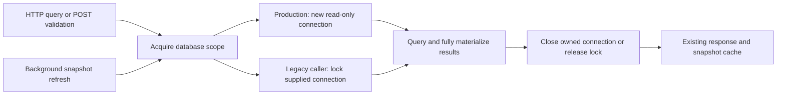

# Code Loop dashboard CPU fix plan

Status: Approved by the user on 2026-10-23 (Asia/Shanghai).
Baseline: origin/master 35d68507660cde0ef2ca5c71da704e452a5e6f88.
Branch: codex/2026-10-23-code-loop-cpu.
Worktree: /Users/momo/.codex/worktrees/code-loop-cpu/skills.

## Architecture Impact: Required
The dashboard database connection lifecycle changes from shared process-wide reads to operation-owned read-only connections. HTTP contracts, storage schema, component responsibilities and deployment topology are preserved. The existing connection fallback is serialized at the application boundary.

## Expected / Delta

## Ordered implementation
1. RED: add deterministic concurrency/ownership tests, background refresh and exception cleanup coverage, read-only opener behavior and server factory wiring assertions. Avoid deliberately racing the real shared Apple SQLite connection.
2. GREEN: add the thread-affine read-only opener in dash/schema.py and expose it through dash/store.py. Keep initialization and write connection behavior compatible.
3. GREEN: add the optional factory and scoped acquisition helper in dash/serve.py. Enclose each route, full result materialization and POST validation read. Keep response encoding, external callbacks and network writes outside borrowed-connection locks.
4. Wire scripts/cp_server.py _ui_listener to the read-only factory. Recheck optional operator consumer interaction: it must no longer share its dashboard connection with HTTP reads. Do not redesign operator Store transactions.
5. REFACTOR: remove misleading serialized-mode assumptions from connection docs/comments. Preserve current single-flight/cache behavior.
6. Synchronize architecture and service documentation from the complete diff, then run an independent Spec Verifier + Cleaner review with all changed files explicitly covered. Resolve valid findings and rerun affected checks.
7. Run relevant existing dashboard/server suites and applicable repository checks, then isolated real HTTP concurrency, latency and CPU QA. Record evidence and remaining deployment limits; deliver a concise actual flow diagram.

## Expected files
services/code-loop/codeloop/dash/{schema,store,serve}.py; services/code-loop/scripts/cp_server.py; focused dashboard/server tests; services/code-loop/README.md; affected architecture docs; this Spec and Plan. Refine exact regression-test placement during implementation without expanding behavior.

## Data / API / Configuration
No schema or user configuration change. Optional internal create(..., db_factory=None) extension and read-only opener only; existing callers remain compatible.

## Validation sequence
Deterministic RED → focused GREEN → dashboard and merged-server regressions → existing applicable static checks and service suite → documentation diff review → independent review → isolated merged-server HTTP benchmark and idle CPU check. Use fixture-only CODE_LOOP_HOME and isolated ports; no credentials or live platform writes. Record environment limitations explicitly.

## Documentation impact
- Update services/code-loop/README.md with connection ownership and diagnostic interpretation.
- Update the applicable existing architecture index/overview and add a dated connection-lifecycle change record referencing the Expected / Delta diagram.
- No project JSON architecture schema or lint:arch command currently exists. Use the existing Markdown architecture format and available checks; do not introduce an unrelated architecture framework.

## Risks and mitigations
- Opening connections adds overhead: read-only connections avoid repeated schema/WAL initialization; verify with actual HTTP latency and CPU measurements.
- The native cache loop is not deterministically reproducible: test the prohibited sharing invariant directly and bound every real benchmark subprocess.
- The running process already contains stuck native threads: code changes cannot recover those threads in place; applying the fix requires deployment and restart after separate operational authorization.
- Native SQLite bug details remain uncertain: claim removal of demonstrated unsafe access, and report whether isolated post-fix measurements meet acceptance criteria.

## QA-driven correction (2026-10-23)
Real merged-server QA with PR numbers matching project ids exposed an existing kanban verdict-map lookup bug: the outer {project: {number: verdict}} map was passed where one project's map was expected, yielding HTTP 400 (KeyError 0). The minimal correction selects verdicts[pid] in dash/views.py; add a real HTTP regression in test_dashboard_connections.py before repeating performance QA and independent review. No response contract or database schema changes. This correction is necessary to exercise the approved representative HTTP main path.
