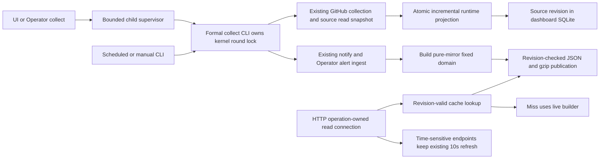

# Code Loop dashboard performance plan

Status: Complete (2026-10-24).
Baseline: origin/main 99ea559f90974d42e70c6cb1673ed58407e05c71.
Branch: codex/2026-10-23-code-loop-dashboard-performance.
Worktree: /Users/momo/.codex/worktrees/code-loop-dashboard-performance/skills.
Spec: ../specs/2026-10-23-code-loop-dashboard-performance.md.

## Architecture Impact: Required
Introduce a supervised collection process and a disposable persistent read model. Runtime mirror writes become explicit atomic incremental updates. HTTP shape, GitHub adapter, CP business rules and operation-owned read connections remain compatible. Time-sensitive endpoints retain their existing refresh behavior.

## Expected / Delta

## Independent planning and decisions
Three independent planners received the same task/context and read code without coordinating or editing. The following decisions are based on actual boundaries, not a majority vote:

- Finite pure-mirror domain instead of all nine reference endpoints: verdicts._cp_verdicts queries dashboard mirrors, making items eligible; operator and runtime are also mirror-only. Kanban reads project CP files and several other endpoints derive now/expiry, so precomputing them indefinitely would change behavior. Keeping them on the old refresh path is simpler than adding a renderer daemon or a new consistency contract.
- Leases use resource identity, because cp.store defines resource as the source primary key; token is updated content. A composite resource/token identity would turn a token change into a needless delete/insert. Converge old duplicate mirror rows when the source snapshot arrives; avoid a fragile startup unique-index migration.
- Use explicit project transactions/savepoints and source read snapshots. with db on an autocommit connection is insufficient.
- Child-owned kernel locking instead of reference TTL/PID takeover: owner exit releases the lock; an active round is never stolen for being old. Compatible inline refresh also observes the same round scope without recursively locking the low-level primitive.
- Keep the existing inline make_refresh callback contract; production wiring explicitly selects the process helper and uses the CLI's notify/Operator path. Do not serialize Python closures or duplicate evaluation.
- Integer source revisions with source-table triggers instead of wall-clock invalidation. Cache metadata/BLOB writes are excluded, and old writers remain visible; the project trigger watches only `id`/`org_repo`, which the builders read.
- HTTP never writes the persistent cache. This avoids the reference implementation's request-time BLOB waits and late-success uncertainty after a write timeout.
- Preserve operation-owned read connections. No long-lived cross-thread connection registry or automatic rollback of other threads' transactions is introduced.

## Ordered implementation
1. Capture independent expected payloads for the three domain builders, enumerate all dependent tables and write entrypoints, and establish isolated pre-change performance fixtures. Keep fixture timezone and input values deterministic.
2. RED/GREEN runtime mirror migration and diff: stable source identities, canonical hashes over current projection values, SQLite affinity compatibility, legacy backfill, unchanged zero-DML, source deletions, token changes and historical duplicate leases. Preserve row ids.
3. RED/GREEN explicit six-table project transaction/savepoint and consistent CP source read transaction. Inject mid-update/source-write failures to prove rollback/snapshot correctness. Keep network/source work outside target writes.
4. RED/GREEN portable per-database round kernel lock, formal CLI skipped/partial result and atomically written machine result file. Include direct CLI and legacy inline entry; do not move the watchdog cursor.
5. RED/GREEN process runner: explicit argv/config path, stdout/stderr bounded drains, default 300-second overall budget, child-side deadline, terminate/kill/reap, parent loss and output overflow cleanup. Wire UI and Operator collect_refresh to this helper; remove only the now-redundant parent alert callback setup.
6. Extract the three pure builders and serialization into serving.py while preserving route/re-export compatibility. Add serving metadata, source dependency triggers, format version and finite cache rows. Implement read-snapshot build and short revision-checked publication; cap batch work and preserve partial-failure fallback.
7. Wire collect completion after notify to optional precomputation. Implement content/gzip dedup and raw/gzip atomicity. The handler does revision-valid read-only lookup and live fallback, with no GET-side persistent writes. Preserve fresh and all non-domain cache contracts, including cold-path generation behavior.
8. Synchronize architecture and user/developer documents from the full diff. Run relevant static checks and regression suites; keep deployed connection tests intact.
9. Independent read-only Spec Verifier + Cleaner + Architect review with full per-file coverage. If >20 files, follow the skill's coherent review-unit rules. Validate and fix actionable findings; rerun affected tests and review.
10. Isolated real CLI/merged-server QA: repeated unchanged collection, concurrent clients during collection, lock/deadline/failed-build/revision-conflict/restart cases, CPU/latency/WAL measurements. Persist exact evidence and actual as-built flow. No production rollout is performed by this implementation proposal.

## Files and boundaries
- Existing dash/schema.py and store.py: additive hash/cache migration, dependency revision triggers and exports.
- Existing dash/ingest.py and collect.py: incremental mirror, explicit transactions, source read snapshot and collect-end publication hook.
- New dash/refresh.py (split a focused collect_lock.py if justified by size): portable round scope, process supervision and machine result contract.
- New dash/serving.py: domain keys, the single pure builder implementation, bounded render, publication and valid read lookup. It must not import serve.py and create a cycle; serve delegates inward and preserves necessary public aliases.
- Existing dash/serve.py: keep connection scope and HTTP contracts; extract enough builder code to avoid growing its current 795-line size beyond the service's established boundary.
- Existing scripts/dashboard.py and cp_server.py: child CLI/result/config plumbing and production assembly. Operator wiring changes only if necessary to select the same collect runner.
- Focused new tests plus existing dashboard/collect/server/CLI compatibility suites.
- This Spec/Plan, services/code-loop/README.md, docs/architecture/modules/code-loop.md, related overview/index if affected, docs/architecture/changes/2026-10-23-code-loop-dashboard-performance.md and final QA evidence.

## Data / API / configuration
- Add nullable content_hash to six display mirrors; add disposable serving metadata/rows and source invalidation triggers. Do not alter CP source schema or authoritative business state.
- Existing HTTP shapes/routes/statuses and public CLI commands remain; add machine-result/config/deadline options and an explicit busy/skipped outcome to collection. Preserve callers not using the new options.
- A validated local collect-timeout setting can override the 300-second default. Output/batch limits and clocks are constructor-injectable for deterministic tests; avoid exposing secrets or implementation details in end-user page flows.
- Dependency inventory is finalized from the sole builders: project identity, issues, prs, comments, work_items, executions, leases, outbox, cp_events, operator_signals and operator_runs. Project collection timestamps/configuration and `pr_reviews` do not affect these three builders. Each new builder dependency must update the declaration and its tests.

## Validation and measurements
- RED before each minimal change; GREEN then refactor.
- Unit: hashes/identity/affinity, unchanged write counts, migration, savepoints, source snapshots, canonical keys, format/revision/gzip/dedup, bounded process lifecycle.
- Integration/contract: real SQLite files and triggers, two competing CLI processes, old writer updates, partial project failure, inline callbacks, notification/Operator configuration, production listener factory and current connection tests.
- API: fixed payload goldens from the pre-change implementation, fresh/dynamic/unknown-query behavior, live CP/time advancement for non-domain endpoints, cached byte/gzip path with aggregate/compressor call counters.
- Real QA fixture: at least three projects, a >=1 MiB items response, and 10,000 combined runtime rows, using fixture-only homes/configs and ephemeral ports. Compare a pristine baseline and optimized code on the same fixture. Reapply unchanged snapshots and measure target DML/WAL delta; exercise 6 clients x100 GETs during collection and record P50/P95, CPU and cleanup.
- Keep request tests bounded (30 seconds), child budgets short/injected for failure cases, and final idle CPU sampling at ten seconds. Use no live platform writes or production data migration.
- Relevant suites must pass. Run the wider service suite when supported; independently reproduce and disclose baseline-only failures rather than weakening assertions. Known baseline at 99ea559: two OptionsEndpointPayloadTests model-detection failures and two platform skips.

## Documentation impact and checks
Architecture Impact: Required; Docs Impact: update current Code Loop module architecture, service README and dated semantic change record referencing the Expected / Delta diagram, plus indexes/overview only where changed. This repository has Markdown architecture contracts and no configured JSON schemas, lint:arch, external formatter or type checker for this service. Use the existing applicable contracts and syntax/diff/test checks; do not introduce an unrelated governance framework.

## Risks and mitigations
- A field affinity or duplicate identity can defeat zero-write behavior: test actual SQLite-bound keys, reject invalid input atomically and preserve old row ids.
- A long collect source/render read snapshot can grow WAL: release source reads before target writes and bound render time/bytes. No hard-coded checkpoint tuning copied from another machine.
- Missing source dependencies can silently stale cache: keep one builder/dependency declaration with write-driven invalidation tests for every table.
- A generation comparison outside the publish transaction is racy: compare under the same writer transaction as batch validity publication.
- Old clients may still write: additive migrations and DML triggers invalidate; old writer writes are a correctness fallback, not a promised performance improvement.
- Losing the parent must not strand a child/lock: child deadline plus kernel lock ownership and tested cleanup; no TTL stealing.
- Result/log parsing ambiguity: atomically written bounded result JSON, with separately drained diagnostics.
- Reverting code leaves disposable new columns/cache objects: old code ignores them; failed caches never become authoritative facts. Any future production schema application needs a normal SQLite backup before rollout.

## Completion evidence

- Implemented the approved incremental six-table mirror, common CP read snapshot, per-database lock, supervised CLI process and revision-fenced JSON/gzip serving domain. The eight existing connection regressions remain in the related integration run.
- Independent review completed three read-only rounds. Its actionable lease-key, cache-read fallback, invalidation-scope and numeric-ID precision findings were fixed and regression-covered; the final reviewer confirmed no blocking findings.
- The related dashboard/collector/connection/refresh/serving/Operator/server suites passed after the final ID normalization change. The command and test count are recorded in the QA document.
- Isolated merged-listener measurements against pristine `origin/main` show 47.8% less dashboard handler CPU for the representative 600 GET load, 13.2% lower P95, zero unchanged-round mirror DML, and 97.4% less uninstrumented WAL. Full method and results: [dashboard performance QA](../qa/2026-10-24-code-loop-dashboard-performance.md).
- The benchmark was on macOS. The portable Windows lock branch was code-reviewed but not exercised on a Windows host; no production deployment or host temperature claim is part of this result.
