# Plan: Operator 到 Worker 常驻智能 Agent

## Architecture Impact

**Required.** 现有项目级 round command 扩展为机器级 typed task 入口；Operator、CP command ledger、WorkerAgent、runtime runner 和本机诊断/维护能力形成新链路。runtime 会话按 task 创建和退出。当前 `docs/architecture/` 只有 Markdown 架构文档，没有 L1-L3 JSON 规范或 `lint:arch` 命令；实现后更新现有 Code Loop 模块/全景文档与语义变更记录，并执行仓库实际存在的相关门禁。

职责定位：Operator 是 CP 侧全局事件协调与路由者；WorkerAgent 是 worker 上的常驻认证接入和执行监督者；Coordinator 是 worker-local、每任务一次的智能分析/委派会话；Handler 才是实际执行仓库修复的 agent。

```mermaid
flowchart LR
  GH[PR review / conflict] --> CP[CP event log]
  WH[Worker stall / discover overdue] --> CP
  CP -->|durable events + cursor| OP[Central Operator]
  OP -->|typed machine task| ML[Machine command ledger]
  ML -->|machine auth / project grant| WA[Resident WorkerAgent]
  WA -->|start per task| RT[Local runtime session]
  RT --> C[Coordinator]
  C -->|pr.repair| H[Independent Handler]
  C -->|worker.project_diagnose| D[Diagnostician / maintainer]
  H -->|CP claim / verify / publish| PR[Original PR]
  D -->|evidence + allowlisted actions| SYS[Worker / project]
  D -->|report + action audit| ML
```

## 方案决策

- 常驻对象是每台机器上的 WorkerAgent command receiver；runtime 不常驻，每条 machine task 启动新的 Coordinator session，需要时再启动 task-specific child agent。
- 使用 machine-scoped command ledger，因为现有 project command 只表示 PR round，不能表达无 PR number 的 worker/项目诊断。项目任务附带 `org_repo`，仍由机器 grant 授权。
- 首期只注册 `pr.repair` 和 `worker.project_diagnose` 两类 task。命令是有版本的 typed envelope；扩展 task 需增加 schema、权限与 handler，不直接接受任意 shell/prompt。
- 项目 repair 沿用 CP Handler work item、隔离 worktree、head guard、verify 和发布流程；Coordinator 负责启动独立 Handler subagent。
- 诊断可以自动执行用户已授权的维护，但只能选择 envelope 和 worker-local registry 共同允许的动作。初期动作包含已登记 code-loop scheduler/service 的 start/restart，以及无活动 discover execution 时的一次性 discover 补跑。动作前后都采样并审计；未登记任务不操作。
- runtime/model 由 WorkerAgent 本地选择：机器默认配置 + 可选项目级 override。Operator 不需要知道远程机器安装了什么。

## 顺序步骤

1. **完成事件与原因身份。** 在 `codeloop/cp/service.py` 中识别新外部 `CHANGES_REQUESTED` review ID、当前 head 的 SENT `Changes requested` outbox operation ID，以及 `mergeable` 新进入 false 的边沿；同一 PR、同次 sync 合并原因并写入 `pr.handler_repair_needed`。保留现有 `PR_REVIEW_FIX` 优先级并在 repair payload 中存完整 `repair_reasons`。
2. **把 worker stall 从告警计算变成可消费事件。** 复用 `dash/health.py` 的 machine×project×loop 活动与阈值计算，默认 discover 18 小时沿用当前配置。将 stalled/resolved 状态边沿持久化，稳定关联 machine、project、loop 与最后 execution；同一未解决边沿不重复发事件。`worker_stall_seconds` 改动仍能覆盖测试和部署配置。
3. **扩展 Operator 的事件消费。** 在 Operator 默认 event kinds/ingest 中加入 `pr.handler_repair_needed` 和 `worker.loop_stalled`；继续用 durable event log + per-scope cursor 恢复，首个 cursor 不回补历史。PR event 生成 `pr.repair`，worker stall event 生成 `worker.project_diagnose`，使用 source event ID 幂等并对活动同目标 task 去重。
4. **增加 machine-scoped command ledger 与协议。** 在 CP server store/registry 增加持久 worker command 表，存稳定 ID、target machine、可选项目、task type/version、JSON args、allowlisted remediation IDs、source event、TTL、lease/status、runtime/execution 关联与 report。增加 enqueue、dispatch-on-connect、ack/progress/result、sweep/TTL API。仅授权 machine 收到目标命令；project-scoped task 必须验证 machine 对该 project 的 grant。保留现有 `review_round` / `repair_round` 项目台账供手动入口使用。
5. **扩展常驻 WorkerAgent 为 task dispatcher。** WebSocket command frame 引入 task schema/version，WorkerAgent 使用显式本地 task registry 拒绝未知版本、任务、参数、project 与权限，再根据 machine runtime default / project override 选择 runner。command ID 驱动本机执行 ledger 和状态恢复。命令执行在后台 task worker，不能阻塞接收/心跳循环。
6. **增加按需 runtime Coordinator 与 subagent contract。** 扩展 `agent_runners.Runner` 的 task launch、model availability、subagent capability、session identity/recovery 接口。WorkerAgent 每条命令临时启动 Coordinator session。PR repair 的 runner 必须支持独立 Handler child；Pi 当前没有 subagent 概念时在预检阶段拒绝。运行时/模型缺失要在 claim 或任何机器动作前明确失败。
7. **实现 PR repair task。** PR repair handler 校验 source event 仍对应当前 PR/head 与 repair work item，执行既有 claim/worktree/bind，再将 execution envelope 交给 Coordinator。Coordinator 以 runtime-native subagent 启动独立 Handler；Handler prompt 按 `PR_REVIEW_FIX`、`PR_CONFLICT_RESOLUTION` 或两者并存处理，并继续用现有 verify/report/`edit_pr`/publish。命令不传 review 正文；Handler 从已授权 CP 上下文获取事实。
8. **实现 worker/project diagnosis 与受限 remediation。** 本机 evidence adapter 采集：WorkerAgent 进程/CP channel 状态，项目注册与路径，CP 最近 claim/execution/ready queue/last seen，`watchdog.jsonl`，本机运行日志，以及平台 scheduler 上已登记 task 的 enabled/last-run/last-result。短期 Coordinator/diagnostic child 分析带来源、时间的 facts；授权时只可调用注册动作如 `discover.run_once`、`scheduler.start_registered`、`scheduler.restart_registered`、`service.start_if_missing`。每个动作先检查授权、精确 target、没有活跃冲突，再执行并 post-check；结果及审计记录写回 machine command ledger。不能观测的根因标为未知。
9. **恢复执行并防止重复动作。** 用 command ID + task action ID 关联 WorkerAgent ledger、runtime session、Handler/diagnostic child 与具体机器操作。重连或进程重启先对账子会话与动作结果，不重开活跃 child，不重复已完成 start/restart/run-once。对不确定的“动作已发出但 ack 丢失”状态先查询实际状态再决定恢复或失败；PR claim release 与命令 retry 遵守现有 fencing/token。
10. **同步架构文档并验证主路径。** 更新 `docs/architecture/modules/code-loop.md`、`docs/architecture.md` 和 `docs/architecture/changes/2026-10-25-operator-review-handler-auto-dispatch.md`。先用 fake CP/worker/runtime 覆盖 PR 与 worker diagnosis 命令端到端；使用隔离测试项目和受控 fake scheduler 验证维护前/后置检查，之后跑相关 code-loop tests 与实际 worker command entry。

## 主要文件

- CP event 与 worker health：`services/code-loop/codeloop/cp/service.py`、`cp/store.py`、`cp/server.py`、`cp/registry.py`、`dash/health.py`、`dash/schema.py`
- machine command ledger/protocol：`services/code-loop/codeloop/cp/command_store.py`（保留 project ledger）、新增 machine task store/module、`cp/commands.py`、`cp/protocol.py`、`cp/server.py`、`cp/client.py`
- Operator：`services/code-loop/codeloop/operator/config.py`、`ingest.py`、`store.py`、`wiring.py`、`scripts/cp_server.py`
- WorkerAgent/runtime/task registry：`services/code-loop/codeloop/agent.py`、`agent_watch.py`、`agent_runners/base.py`、`agent_runners/__init__.py`、claude/opencode/pi runner、`cp/runtime.py`、`scripts/worker_agent.py`；新增 task coordinator、diagnostic evidence 和 maintenance adapter 模块
- PR Handler：`services/code-loop/codeloop/review_round.py`、`trigger.py`、`code-loop/references/handler.md`、`code-loop/references/operator.md`
- 本机诊断：`services/code-loop/scripts/watchdog.py` 与 scheduler adapter；只对显式登记的 task/service 执行动作
- 架构：`docs/architecture/modules/code-loop.md`、`docs/architecture.md`、`docs/architecture/changes/2026-10-25-operator-review-handler-auto-dispatch.md`
- 测试：现有 `test_control_plane_service*`、`test_operator_*`、`test_agent.py`、`test_agent_runners.py`、`test_watchdog.py`，并按实现新增 machine command protocol/recovery、diagnostic evidence 和 maintenance allowlist 测试。

## 数据、接口与配置变化

- CP 新增 durable machine command ledger，支持机器目标与可选项目目标、typed task payload、权限、TTL、状态、结果和审计记录；新增对应 WorkerAgent enqueue/ack/progress/result API 与 websocket frame schema。
- CP event log 增加 `worker.loop_stalled` / resolved 状态边沿；`pr.handler_repair_needed` 复用项目 event log。Operator store 复用游标 meta，machine task 以 source event ID 幂等。
- WorkerAgent 本机配置增加 coordinator runtime/model 默认值和 per-project override；不启动常驻 runtime 服务。
- `agent_runners` 增加按 task 启动 Coordinator、启动独立 child、查询 session、报告能力的接口。Unsupported runtime 不可运行需要 subagent 的 task。
- machine task report 包含证据来源/采集时间/结论/维护动作前后状态；worker-local ledger 保存 runtime session 与 action id 的恢复关联。
- maintenance action registry 以静态或本机配置 allowlist 表达；task payload 的权限不能大于 worker 本机 allowlist。

## 测试与 QA 顺序

1. **PR events：** 新 external review、当前 head SENT verdict、mergeability false edge 触发；重复 sync、首次历史、Approval、单独 Validation failed、draft/closed、错误 base、null 不触发；同 PR 原因合并。
2. **Worker stall event：** discover 默认 18h 与配置阈值；首次进入停摆只写一条事件，恢复写 resolved，持续停摆无重复事件；机器未注册/吊销/无历史时不误报。
3. **Machine task protocol：** machine auth、project grant、unknown task/schema、过期命令、离线 pending、reconnect dispatch、ack/TTL 与重复 source event 均有断言。
4. **PR repair Coordinator：** 新 Coordinator 与独立 Handler child；Handler task/reasons 正确；Coordinator 不修改文件；CP claim/head guard/report/publish 原有契约保持。
5. **Diagnostics evidence：** fake worker DB, watchdog log, process/channel state 和 fake scheduler 生成带 timestamp/source 的证据；缺日志/非支持 OS 时报告未知，不推断根因。
6. **Automated maintenance：** allowlist 内 start/restart/run-once 按顺序执行 precheck→action→postcheck 并审计；非 allowlist、错 project/task、活跃 discover、重复 action ID、无法验证和 ack 丢失均不得造成第二次副作用。
7. **Restart/recovery：** WorkerAgent 重启与 CP reconnect 后 command、runtime session、child session 和维护动作的状态可恢复；离线机器命令仍遵守 TTL；同一 PR/diagnostic source 不产生第二个活动任务。
8. **服务 QA：** 运行 CP/Operator/WorkerAgent/runtime 相关测试，随后 code-loop 全服务套件；用隔离 worker 和 fake runtime 通过正式 websocket command path 检查 PR repair 与 discover diagnosis/允许维护两条主路径，不对用户 PR 或真实 scheduler 执行未批准的操作。

## 基线与交付

本任务分支基于已正式评审但尚未合并的 PR #22 (`codex/2026-10-25-operator-event-consumer`)；本功能同时扩展 Operator durable event consumer 与 worker command dispatch。PR #22 合并后，将本功能 PR 的 base 调整到 `main`，避免重复包含 #22 改动。

## 实现后的文档影响记录

- **Docs Impact: Required.** 已同步 `docs/architecture/modules/code-loop.md`、`docs/architecture/modules.md`、`docs/architecture.md` 和 `docs/architecture/changes/2026-10-25-operator-review-handler-auto-dispatch.md`。
- 根目录 `README.md` 不含 managed architecture picture block；`docs/architecture/` 当前没有 L1-L3 JSON 规范，也没有适用的 `lint:arch` 命令。
- As-built 图见变更记录；它保留了设计中的事件 → Operator → machine ledger → WorkerAgent → per-task Coordinator → Handler/diagnosis 主链路，并补出 worker-local idempotency journal、terminal event query 与 claim release 边界。
- WorkerAgent 本机 journal 记录 runtime PID 与 PR claim fence。重启后保留仍运行的 PID 并等待；无法判断已退出的进程结果时记录失败、清理干净 worktree 并释放 claim，不重新启动可能已完成的 Handler/维护动作。
- Machine task 的 Operator 默认 TTL 为七天；过期离线任务只在授权并完成本地项目注册的 worker 重连时重新排队，具体 PR head / stall freshness 仍在执行前复核。CP 将超过五小时未更新的 RUNNING task 终结为失败。
- PR freshness 以 head SHA 和 base ref 为准，base SHA 更新不使 repair task 永久失效；Coordinator 的自由文本 session ID 不作为 Handler 已启动的证明，必须有 runtime-native Task/subagent 调用及完成证据。
- Worker task 只有在 exact CP execution 查询确认 `SUCCEEDED` 后才返回成功；Task 子调用已完成但 CP claim 仍 active/missing/failed 时，worker task 带 execution/token fence 报失败并由 CP 收口 claim。
- CP event 与 Worker task 回调都只投递 wakeup；消费端分别从项目 CP event log 和 registry durable event log 按 ID 顺序回放并推进 cursor，rollback wakeup 不会派发任务。诊断 remediation 每次动作前复核 stall 对应的最后 execution，重复 action ID 在同一响应内只执行一次。
- Worker hello 登记本地项目路径后立即补派 machine task。持续 merge conflict 下检测到 PR head 或 base SHA 更新，会生成新 source event，允许旧 head 的 terminal failure 后创建新 repair task。
- Worker hello 同时公告 task schema 版本。缺少兼容版本的旧 Worker 不接收 typed task；过期任务只在兼容 worker 完成 hello 后才重新排队。
- `docs/architecture/changes/2026-10-25-operator-review-handler-auto-dispatch.md` 的 as-built 记录包含 wake/replay、TTL/reconnect、freshness、native subagent 证据和维护动作去重边界。
