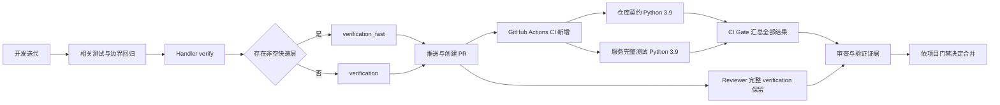

# 测试分层与 GitHub Actions 实施计划

状态：实现与单版本调整完成；独立 Review 和本地 QA 已通过。

对应规格：[Spec](../specs/2026-10-25-tiered-tests-actions-ci.md)。

## 推荐方案

复用现有快速／完整验证分层，修正文档，新增完整 GitHub Actions CI。先建立可见、稳定的 CI 检查，保持 Reviewer 完整验证；未来考题接入、强制状态检查和证据复用分别处理。

## Expected / Delta

图中的 CI Gate 先提供检查结果；成为 GitHub 强制合并检查需要另行配置分支保护。code-loop 是否等待 CI 仍由目标项目的 required_checks 决定，当前不得声称已完成该接入。

## 实施步骤

1. **回归基线与 TDD**
   - 使用已有 `ExamParseTests.test_resolve_verification_kind_tiers` 和 Worker 快速层端到端测试确认既有行为；不为未修改的逻辑添加重复单测。
   - 先为新增工作流编写必要契约测试，使缺失 workflow、遗漏测试入口或错误结果汇总出现可复现失败，再实现工作流。
   - 测试断言可观察门禁行为，避免只逐行复刻 YAML。以 actionlint 等官方语义兼容的静态工具验证表达式；本地逻辑检查不冒充真实 Actions 执行。
2. **对齐分层说明**
   - 修改 `code-loop/references/handler.md`：相关回归先行，verify 层级由配置与轮次决定；移除一律全量措辞。
   - 修改 `code-loop/SKILL.md`、`code-loop/references/control-plane.md`：补齐快速层示例、缺省回退及独立 PR 生效约束。
   - 修改 `code-loop/references/reviewer.md`：明确 Reviewer 始终完整验证，检查 CI 不能代替本地 verify；报告只声明实际通过的检查。
3. **新增 CI**
   - 添加 `.github/workflows/ci.yml`，采用 Spec 规定的触发器、Python 3.9 基线与 job 布局。
   - 仓库契约和服务套件在同一 Python 3.9 版本的独立 job 中并行运行，最终输出稳定的 `CI Gate`。
   - 为结果汇总设置 `always()` 和严格成功判断；固定 Action SHA、只读权限、显式超时及并发取消策略。
   - 不添加 `.code-loop/verify.json`，避免在工作流尚未生效时改变目标项目原有考题来源或引入不存在的必需检查。
4. **文档与架构同步**
   - README 添加验证入口与 CI 状态说明；CLAUDE 维护稳定的验证指引。
   - 服务 README 说明完整 CI 覆盖及本地定向测试方式。
   - 更新现有架构文档的验证流程；添加 `docs/architecture/changes/2026-10-25-tiered-tests-actions-ci.md`，引用本方案图。
   - 将 `.code-loop/verify.json` 快速层接入与 `CI Gate` 必需检查配置列为明确后续操作，不描述为本次已生效。
5. **独立审查与 QA**
   - 邀请未参与实现的 Subagent，以 Spec Verifier + Cleaner 审查所有 `(path, status)`、最终 diff、架构与文档。
   - 修复有效阻塞问题，重跑受影响检查；执行下述本地验证并记录结果。
   - 若后续交付包括推送/PR，检查真实 GitHub Actions 的状态和日志；在远端执行之前只报告本地结果。

## 验证策略与顺序

1. 新增工作流契约测试：缺失工作流 RED → 实现后 GREEN；覆盖三个触发入口、单版本的两个测试 job 和 Gate 对失败/取消/跳过的处理。
2. 原有分层测试：`python3 services/code-loop/tests/test_control_plane_runtime.py`；定向执行 Worker 中已有的快速层端到端测试，核对具体方法名后运行。
3. 工作流 YAML 解析与 actionlint：确认 Actions 表达式、事件、job 依赖与安全配置。
4. 仓库契约：`python3 -m unittest discover -s tests -p 'test_*.py'`。其中已启动 skill 子套件，不另行重复。
5. 服务完整套件：`python3 -m unittest discover -s services/code-loop/tests -p 'test_*.py'`。这次属于新增 CI 入口的基线验证，不能只以定向测试代替。
6. 与 CI 一致的 Python 源文件编译检查；`git diff --check`；审查完整工作区 diff。
7. 本机 Python 3.9.6 与 CI 的 3.9 主次版本一致；由真实 CI 验证 Ubuntu 运行结果。

## Verification evidence

- `[PASS]` 新增工作流契约：`python3 -m unittest tests.test_github_actions_ci`，5 tests passed；测试覆盖 PR/main/manual 触发、两个测试 job 均使用 Python 3.9、权限与 action SHA、依赖结果映射、失败/取消/跳过拒绝，以及全成功通过。
- `[PASS]` 原有快速层解析/选择回归：`python3 -m unittest services.code-loop.tests.test_control_plane_runtime.ExamParseTests.test_resolve_verification_kind_tiers`。
- `[PASS]` 根目录完整契约：`python3 -m unittest discover -s tests -p 'test_*.py'`，22 tests passed。
- `[PASS]` 服务完整套件：`TZ=Asia/Shanghai python3 -m unittest discover -s services/code-loop/tests -p 'test_*.py'`，1,482 tests passed，2 个 Windows 专属 `mbcs` 测试在 macOS 按既有规则跳过。
- `[PASS]` Python 源编译检查、`git diff --check` 和 actionlint 1.7.12。actionlint 的 macOS arm64 发行包校验和验证通过后用于检查 `.github/workflows/ci.yml`。
- `[PASS]` code-loop skill frontmatter/body 手动验证；Skill Creator 的 `quick_validate.py` 需要本环境未安装的 PyYAML，因此没有声称该验证器通过，也未为单次检查安装依赖。
- `[PASS]` 独立只读 Review：未发现阻塞或高严重度问题；Reviewer 核实工作流事件、解释器版本、固定 Action SHA、最小权限及 Gate 失败关闭行为。
- `[FIXED]` 首次 Ubuntu 运行发现两个测试环境问题：本地日期测试依赖 UTC+8，而 hosted runner 默认 UTC；OpenCode 测试夹具在不同会话间复用消息文件名。CI 已固定 `TZ=Asia/Shanghai`，夹具改为会话唯一 ID；两个定向测试和本地完整服务套件均通过。

## 风险与交付边界

- 全量服务套件可能存在平台、时间或历史失败；先记录和定位原因，必要修复须与 CI 可复现性直接相关，禁止删除/弱化用例。
- Ubuntu 上的成功不覆盖 Windows 特有 teardown 与进程管理行为；本次不扩展平台支持承诺。
- 首版 CI 对文档 PR 也执行完整测试，保证稳定检查可发现，避免 paths 过滤使必需检查永久 Pending。未来按测得耗时再设计任务级分流。
- Reviewer 与 CI 的重复完整验证暂时保留；可信复用需要提交、考题、环境与证据有效性的独立设计。
- 仓库机器本地配置未读取也不修改；已有 code-loop 项目只有在维护者配置快速层后才会加速。
- main 目前没有 required status checks；本次只新增 CI 工作流，不自动把它设为合并硬门禁。需要强制执行时，把运行确认的稳定检查追加到分支保护并保留既有设置。

## Architecture / Docs Impact

Architecture Impact: Required。变更共享开发与验证流程，沿用现有 Markdown 架构文档；不更改 CP 公共接口、数据模型、部署拓扑或验证信任模型。

Docs Impact: Required。范围为 code-loop 规则与考题示例、根 README/CLAUDE、服务 README、现有架构总览及 code-loop 模块文档、语义变更记录。

无现有 `lint:arch` 或正式 JSON 架构规范入口；使用项目已有契约测试和完整 diff 审查，不虚构架构门禁。
