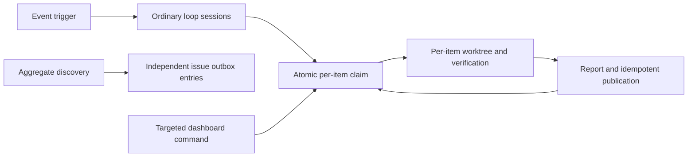

# Code-loop round throughput — Plan

Architecture Impact: Required. This changes work scheduling, default resource ownership, and trigger dispatch; update architecture documentation to match implementation.

1. Reproduce actual bottlenecks and add failing tests for multi-item rounds, default and explicit concurrency, resource conflicts, trigger races and discovery batches above ten, including recovery.
2. Adjust CP configuration and resource derivation without weakening same-resource fencing. Maintain compatibility for existing explicit concurrency and scopes.
3. Update normal loop instructions for repeated per-item lifecycles; keep dashboard-directed operations scoped. Extend discovery batch validation and publication with existing outbox reconciliation.
4. Adjust event-trigger dispatch/cursor semantics to support independent work and safe partial failure; document any changed defaults and operational tradeoffs.
5. Update code-loop references and formal architecture documents. Run focused concurrency and publication tests, relevant full suite and applicable architecture checks; exercise real CLI paths. Independently review changes and resolve blocking findings.

QA must prove no duplicate claims or publication under concurrent calls, no loss on partial failures, compatibility of explicit settings, and isolated cleanup. Record any environment-dependent checks as blocked rather than passed.
