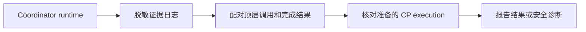

# Issue #47：实施计划

状态：实现、独立复审和 QA 完成；2026-11-08 用户同意先完成证据识别，进程树强隔离另行处理。Spec：[handler evidence](../specs/2026-11-07-issue-47-handler-evidence.md)。

1. 移除新增的进程树跟踪、sentinel、worker task 恢复变更、CP renew 端点和数据库迁移，保留既有运行/恢复契约。
2. 保留独立的脱敏输出 sink、Claude `Agent` / `Task` 配对、OpenCode 受支持格式和精确 execution 校验。
3. 以隔离 subprocess 和脱敏样例覆盖成功、未完成、失败、嵌套、多调用、跨 execution、日志隐私及 CP 双门禁；运行相关项目测试。
4. 同步实际架构、操作说明与 QA 记录，独立复审完整改动，修复阻塞问题。

Architecture Impact: Required。PR repair 的 runtime 日志由独立输出 sink 投影为脱敏证据；CP 接口、数据模型及平台路由不变。Docs Impact: 更新 code-loop 架构和 Operator 文档，清除强隔离承诺。进程树强隔离的已知风险及 XPC 实验结果另记本 Spec，由 [Issue #52](https://github.com/helloimcx/skills/issues/52) 后续处理。
