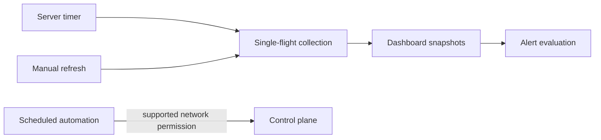

# Code-loop recovery plan

Architecture Impact: Required — server gains a lifecycle-managed periodic dashboard collection driver and a shared single-flight boundary.

Docs Impact: update the service README, code-loop module architecture and change record. This repository does not currently have L1–L3 architecture JSON or an overview matrix for this service.

1. Trace server and UI collection lifetimes and existing locking, then add regression tests for periodic operation, shared exclusion, failure recovery and clean shutdown.
2. Implement the smallest server-owned periodic collector using existing collection and alert wiring. Document the interval and disable setting; update architecture records as appropriate.
3. Identify a supported project-specific automation permission path and verify it with a read-only control-plane request before changing any scheduled execution. Avoid global security changes and direct database edits.
4. Run focused tests and repository verification, perform independent review, then stage a reversible deployment. Verify actual snapshot timestamps across intervals and a fresh automation execution; record remaining scheduler or permission limitations.
