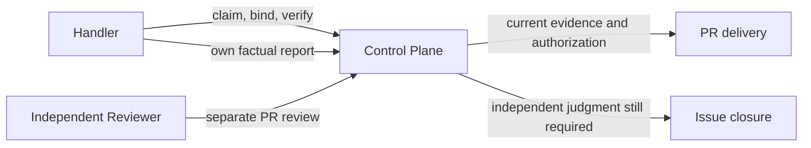

# Handler report identity implementation plan

Architecture Impact: Required — publication gate semantics change at the existing Control Plane boundary; no new component, schema or public fields.

1. Reproduce the current same-worker report and subsequent publish rejection using meaningful integration tests and capture RED. Inspect all Handler actions and preserve unrelated semantics.
2. Limit report identity exception to the specified Handler outcomes and replace the Handler ordinary PR publication independence check with current-execution judgment freshness checks; retain all evidence, authorization, fencing, and independent closure/reviewer gates. Resolve the unused duplicate validator carefully.
3. Add negative regression tests for stale/missing evidence, head/version/fence changes, unauthorized action, Reviewer self-review and issue closure; cover the report-to-publish path and existing independent reports.
4. Synchronize architecture facts, change record, skill guidance and applicable overview/README; run applicable architecture checks and relevant suites in isolated HOME/CODE_LOOP_HOME and credentials.
5. Obtain independent review, fix findings and rerun. Exercise a local isolated Control Plane via its actual CLI/API and measure the relevant path. After successful checks, deploy through the established reversible release process, then verify a real permitted task without duplicating PR actions or interfering with existing leases.
6. Update the AgentDock scheduled prompt to match the verified contract, preserving its schedule, permissions and single-claim constraint; inspect a new actual run for report and publication outcome. Record limitations rather than asserting completion if external state prevents the full path.

Docs impact: handler reference, service README, module architecture and change record. This repository has no L1–L3 JSON specifications, architecture overview, README managed architecture block, or lint:arch command.
