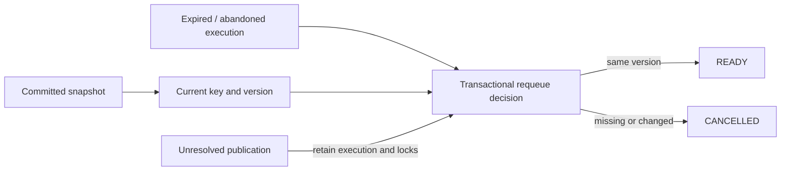

# Expired work item requeue plan

Architecture Impact: Required — fixes a state transition within the existing Control Plane store; no new components or interfaces.

1. Reproduce sync-removal followed by expiration and claim; verify failure before the change.
2. In the shared transactional requeue helper compare the item with the latest committed current_versions map; preserve legacy behavior if the map is absent and successor protection.
3. Filter stale preexisting READY candidates inside the claim transaction. Exercise current, removed and changed facts; no-metadata, unresolved-publication, idle collapse, abandon and steal.
4. Update architecture and run isolated targeted and full tests, independent review and actual isolated HTTP/CLI QA.
5. Submit PR; deploy only after verified integration with current main, preserving data and previous release. Confirm actual scheduled runs rather than assuming recovery.
