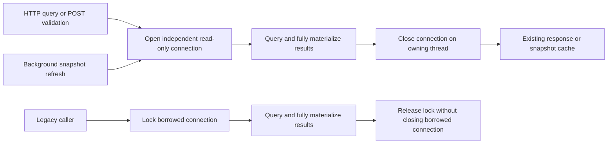

# Code Loop CPU fix verification

Date: 2026-10-23, Asia/Shanghai. Branch: codex/2026-10-23-code-loop-cpu; baseline: origin/master 35d6850.

## Changes and limits

Production HTTP routes, POST validation and background snapshot refresh acquire operation-owned read-only SQLite connections, fully materialize results and close them on the owning thread. Legacy supplied connections are serialized within the handler. Real HTTP QA additionally exposed and corrected a one-line per-project verdict map lookup in the kanban path.

The code removes an established unsafe sharing pattern on the affected THREADSAFE=2 build. The native SQLite cache loop's precise original trigger remains unproven. The resident production PID was not restarted or modified: these measurements describe a separate isolated process using the fixed worktree, not a measured reduction on the running production service.

## Automated verification

- RED: old implementation failed the deterministic legacy-overlap test; five other new cases failed because factory/read-only support did not exist.
- GREEN: all 8 final connection and real-HTTP regression tests pass. An independent reviewer separately reran them.
- QA-driven RED: PR number 1 / project id 1 returned HTTP 400 with error 0. Selecting verdicts[pid] restored HTTP 200, verified by the new regression.
- Existing dashboard suite at the connection-fix checkpoint: 306 tests passed in 74.684 s. After the kanban correction: all 78 kanban tests and all 8 new connection tests passed.
- Existing merged-server suite: 49 tests passed in 24.141 s.
- Repository contract suite: 17 tests passed.
- Full service suite at the connection-fix checkpoint: 1401 tests ran in 225.055 s; 1397 passed, 2 failed, 2 skipped. This was not an all-green run. The only failures were test_agent_runners.OptionsEndpointPayloadTests.test_options_is_cached_within_the_ttl and test_options_lists_every_plugin_with_detected_models. Both fail identically when their class is run against a clean origin/master service snapshot in this environment (expected two modeled-plugin detections, observed one; opencode model list empty). These tests and their implementation are unchanged. No unrelated test was weakened or bypassed.
- Python syntax: all six changed Python files parse successfully. git diff --check passed. No configured lint/typecheck/JSON architecture schema/lint:arch exists for this service; the README explicitly documents that exception.

## Independent review

A reviewer uninvolved in implementation inspected all code, tests, architecture documents and the approved baseline; no unresolved Critical/High finding. A second review covered the QA-driven kanban change and confirmed the native HTTP benchmark uses real queries and an isolated real entrypoint. The report itself is a later evidence artifact.

## Real merged-server HTTP and CPU QA

The normal cp_server.py serve entrypoint ran in a subprocess with isolated fixture home, CODE_LOOP_HOME, server config, database and ephemeral ports. Only home resolution was injected; HTTP routing and SQLite queries were real. The fixture had 3 projects, 60 issues and 60 PRs. Six clients each sent 100 uncached GETs across overview/items/queue/kanban/workers/events. A missing-project POST correctly returned 404. Closing stdin stopped the fixture service with exit 0; fixture files and the temporary runner were removed.

```json
{
  "result": "PASS",
  "requests": 600,
  "concurrent_clients": 6,
  "fixture_projects": 3,
  "fixture_issues": 60,
  "fixture_prs": 60,
  "elapsed_seconds": 4.441,
  "median_ms": 41.23,
  "p95_ms": 115.53,
  "max_ms": 145.14,
  "load_cpu_seconds": 5.11,
  "idle_interval_seconds": 3,
  "idle_cpu_percent_of_one_core": 0.0,
  "entrypoint": "cp_server.py serve; isolated home and ports",
  "post_unknown_project_status": 404
}
```

CPU uses per-process ps cumulative CPU time; the three-second idle reading is rounded to the available timer resolution. It does not claim zero CPU under every workload. The fixture met the approved 30-second completion bound and idle CPU <5% of one core. Failed setup attempts before the final run used an incorrect fixture data path, then exposed the documented existing kanban bug; both fixture services were cleaned up.

## Acceptance criteria evidence

| Criterion | Result | Evidence |
|---|---|---|
| 1: independent factory ownership / no shared concurrent use | PASS | parallel actual HTTP test; tracked creator/query/close thread ids; legacy overlap RED/GREEN |
| 2: background refresh and failure cleanup | PASS | background last-good preservation and exception cleanup tests |
| 3: borrowed connection compatibility | PASS | serialization test; existing endpoint tests; caller can still query after requests |
| 4: POST validation and cache contracts | PASS | factory validation test and existing dashboard suite |
| 5: read-only, existing-file-only, URI-safe and thread-affine | PASS | write/missing-file/thread-affinity/special-character-path regression |
| 6: relevant regression suites / broader baseline diagnosis | PASS with baseline caveat | relevant suites green; full-suite two existing failures reproduced on pristine origin/master; two platform skips recorded |
| 7: real entrypoint, concurrency and idle CPU | PASS | 600 requests in 4.441 s; idle CPU 0.0% at timer resolution over 3 s; child exit 0 |
| 8: review and synchronized documentation | PASS | two independent review rounds; updated current module doc and dated architecture change record |

## Actual flow


